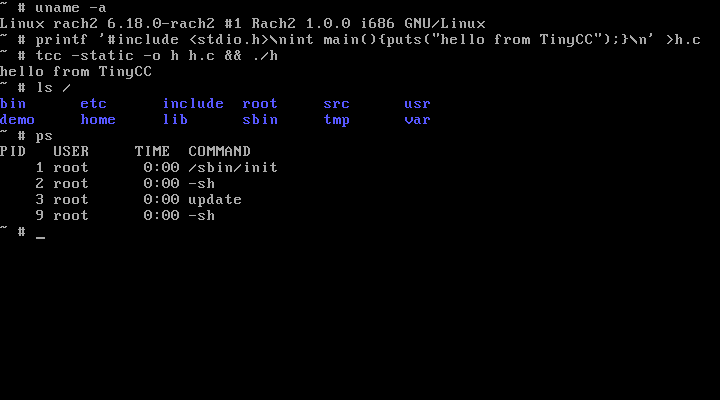

# Rach2

Rach2 is an operating system for 32-bit and 64-bit x86 PCs, written to be read by students and developers who want to see how a Unix-like system works. Its kernel, in freestanding C89, offers Linux's system call interface for each architecture, 284 calls on i686 and 261 on x86-64, so it runs ordinary programs built against a port of the musl C library: the BusyBox shell and tools, the Dropbear SSH server, the TinyCC compiler, pdpmake and Doom.



## What it does

* Log in on the console or over SSH ([`rach2(7)`](man/man7/rach2.7), [`dropbear(8)`](man/man8/dropbear.8)).
* Compile C programs on the machine, and rebuild the kernel from the sources in `/src` ([`tcc(1)`](man/man1/tcc.1), [`make(1)`](man/man1/make.1)).
* Mount ext2, FAT32, exFAT and KRFFS, its own file system, from disks, USB flash drives and image files ([`mount(8)`](man/man8/mount.8), [`loopctl(8)`](man/man8/loopctl.8)).
* Use IPv4 networking: DHCP, `ping`, HTTP and SSH ([`rach2/sys/network/`](rach2/sys/network/Readme.md)).
* Play Doom with sound, given its game data file ([`doom(1)`](man/man1/doom.1)).
* Install it on a PC's disk, which boots by BIOS or UEFI, and update it later ([`rach2-install(8)`](man/man8/rach2-install.8), [`recovery(7)`](man/man7/recovery.7)).
* Read the manual on the machine with `man` ([`man(1)`](man/man1/man.1)).
* Build, on a Linux host, a larger root with glibc, GCC, bash, Python and Git ([`vendor/gnu/`](vendor/gnu/Readme.md)).

## Status

Rach2 runs in QEMU, where its tests run, and on one real machine, a Lenovo G50-70 laptop, which boots the x86-64 kernel by UEFI from a SATA disk. It uses up to 64 processors with one lock over the kernel, so programs run on every processor at once and the kernel on one at a time. The network is IPv4 only, USB works only through xHCI controllers, and there is no swap. The programs of the musl system are linked statically. [`limits(7)`](man/man7/limits.7) lists the numeric limits.

## Quick start

The build needs GNU Make, a host C compiler, the `i686-elf` cross toolchain, QEMU and a few other tools. [`tools/Readme.md`](tools/Readme.md) installs them on macOS, Debian and Ubuntu, and `sh tools/setup/doctor.sh` reports what is missing.

```sh
git clone https://github.com/toksaitov/rach2.git
cd rach2
make
rach2/run.sh os-real
```

The first `make` takes some minutes. `run.sh` starts QEMU and shows the console in the terminal, through the serial port, and in QEMU's window when the host has a display; over ssh there is no window. Log in as `root` with the password in `krffs/rach2_demo_password`, which the build creates. `poweroff -f` stops the machine.

For x86-64, install the `x86_64-elf` toolchain, build with `make ARCH=x86_64`, and boot with `ARCH=x86_64 rach2/run.sh os-real`. [`tests/Readme.md`](tests/Readme.md) describes the tests.

## The source

| Directory | What it holds |
| --- | --- |
| [`rach2/`](rach2/Readme.md) | the kernel and its run scripts |
| [`utils/`](utils/Readme.md) | the in-house programs: init, login, network, disks and recovery |
| [`ish/`](ish/Readme.md) | the small shell of the os-simple image |
| [`krffs/`](krffs/Readme.md) | the KRFFS host tools and the image manifests |
| [`ports/`](ports/doom/Readme.md) | the Doom port |
| [`vendor/`](#license-and-third-party-sources) | the third-party projects and the GNU layer |
| [`tests/`](tests/Readme.md) | guest probes, host tests, system suites and fuzz harnesses |
| [`tools/`](tools/Readme.md) | machine setup, image builders and the style checks |
| [`mk/`](mk/Readme.md) | the Make rules the components share |

The manual, 169 pages that the os-real image installs, is in [`man/`](man/Readme.md). [`dev-log/`](dev-log/Readme.md) records how each milestone was planned and built. [`AGENTS.md`](AGENTS.md) is the policy every change follows.

## License and third-party sources

The repository declares no license for its own code. Third-party code keeps its upstream license, which is in its source:

* [musl](vendor/musl/Readme.md), [BusyBox](vendor/busybox/Readme.md), [Dropbear](vendor/dropbear/Readme.md), [TinyCC](vendor/tcc/Readme.md), [pdpmake](vendor/pdpmake/Readme.md) and [e2fsprogs](vendor/e2fsprogs/Readme.md) are release tarballs, checked by SHA-256 before they are built.
* [`vendor/grub/`](vendor/grub/Readme.md) has eight GRUB boot images and their provenance.
* [`vendor/gnu/`](vendor/gnu/Readme.md) fetches the GNU layer's sources and checks their digests.
* The Doom engine in [`ports/doom/`](ports/doom/Readme.md) is doomgeneric, under the GNU General Public License.
* `krffs/vendor/` has termbox2, and `rach2/vendor/` the Multiboot header.
