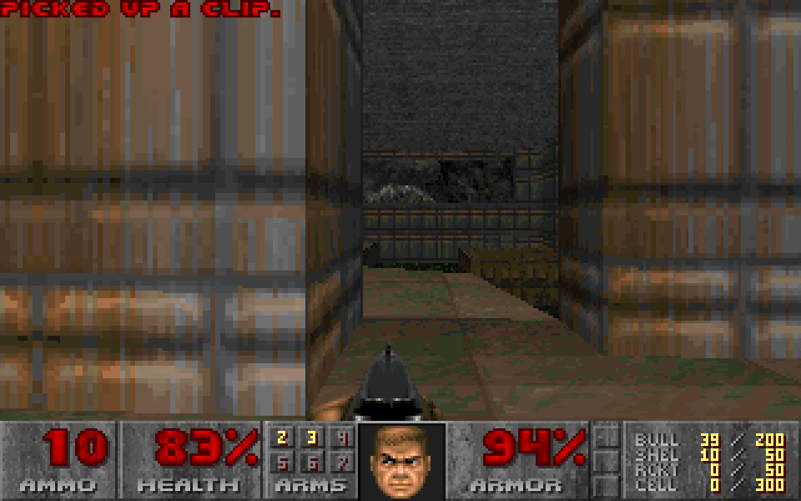
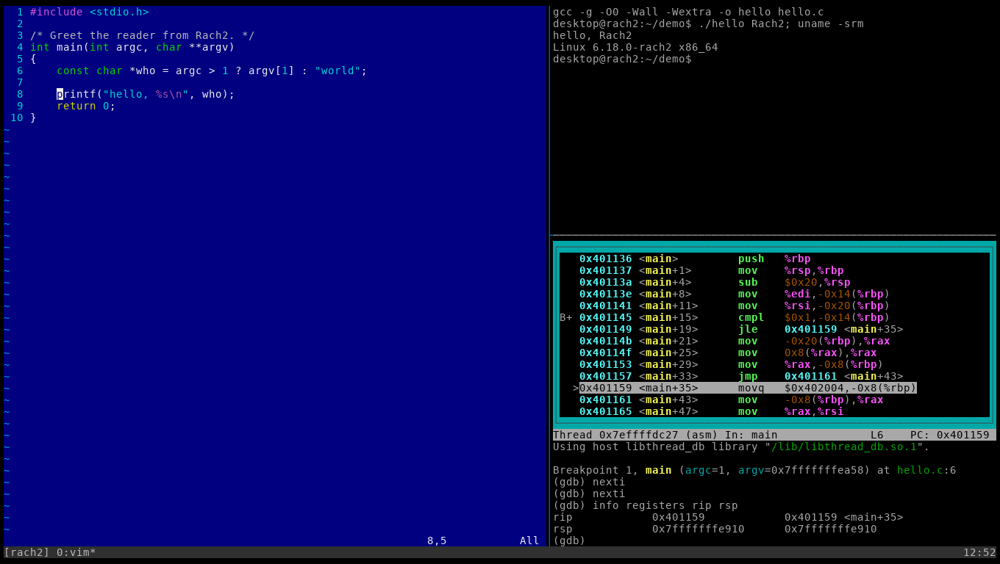
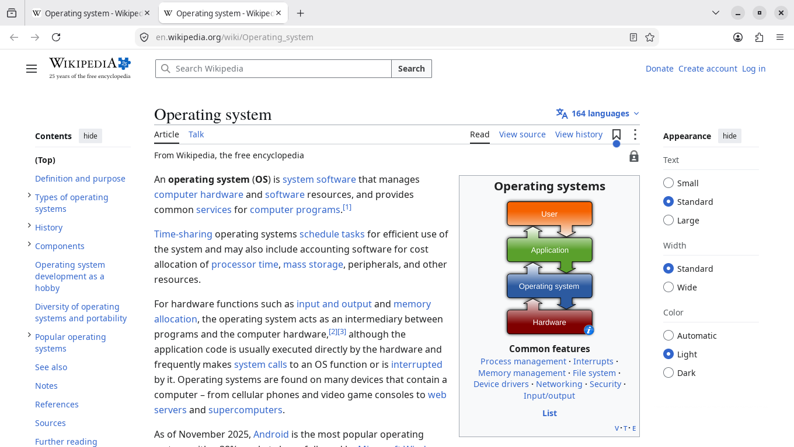
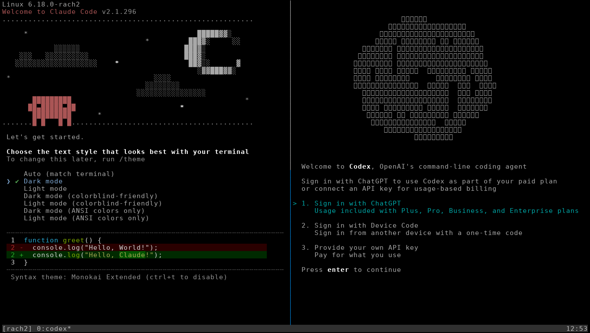
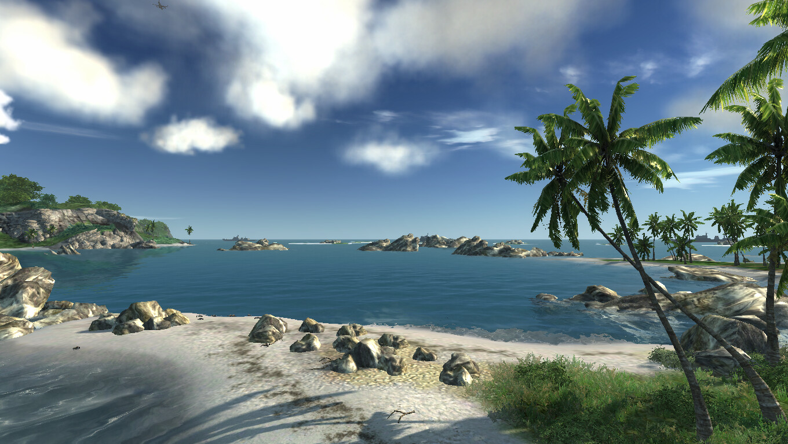

# Rach2

Rach2 is an operating system for 32-bit and 64-bit x86 PCs, built in one year with coding agents at the American University of Central Asia in Kyrgyzstan. Its kernel is its own, in freestanding C89, written to be read by students and developers who want to see how a Unix-like system works. It has Linux's system call interface, so programs written for Linux run on it unchanged: a Wayland desktop with Firefox and Chromium, GCC, GDB, Python and Git, Windows programs through Wine and Proton, and the coding agents that wrote it, Claude Code and Codex.


The same tour is a [video](.github/media/tour.mp4).

Two systems of programs run on the one kernel, and the rest of this page calls them by these names:

* The musl system is the small one: a console system of statically linked programs, with a shell, an SSH server, a C compiler, the manual and Doom, which `make` builds from this repository alone into a 40 MB image.
* The GNU system is the large one: glibc and the GNU programs, GCC and GDB, a desktop with Firefox and Chromium, Wine and Proton, installed over the musl system in a disk image.

## Getting started

### In the browser

[toksaitov.github.io/rach2](https://toksaitov.github.io/rach2/) boots the musl system in a PC emulator, with nothing to install, on a phone too. Log in as the page says, then type `doom`, or compile `hello.c` with `tcc`. [The musl system](#the-musl-system), below, says what else it does.

### In QEMU

The [latest release](https://github.com/toksaitov/rach2/releases/latest) has an image of the musl system, with the one command that starts it. The GNU system is built from source, as [`vendor/gnu/Readme.md`](vendor/gnu/Readme.md) says.

### Building from source

These commands build the musl system and boot it in QEMU. [`vendor/gnu/Readme.md`](vendor/gnu/Readme.md) says how to build the GNU system.

Building and booting need GNU Make, a host C compiler, the `i686-elf` cross toolchain and QEMU, among other tools: [`tools/Readme.md`](tools/Readme.md) lists the packages for macOS, Debian and Ubuntu, and `sh tools/setup/doctor.sh` reports what is missing.

```sh
git clone https://github.com/toksaitov/rach2.git
cd rach2
make
rach2/run.sh os-real
```

The first `make` takes some minutes. `run.sh` starts QEMU with the console on the terminal, and in a window if there is a display. Log in as `root` with the password in `krffs/rach2_demo_password`, which the build creates; `poweroff -f` stops the machine.

For x86-64, install the `x86_64-elf` toolchain, build with `make ARCH=x86_64`, and boot with `ARCH=x86_64 rach2/run.sh os-real`.

## The musl system

The musl system is on every image. Its programs are linked statically with a port of the musl C library: the BusyBox shell and utilities, the Dropbear SSH server, the TinyCC compiler and pdpmake, a POSIX make, e2fsprogs, and Rach2's own programs for login, the network, disks and recovery. Doom is linked statically with a small C library of its own. [The list of programs](man/programs.md#the-musl-system) gives each with its version and manual page.

On it a person can:

* Log in on the console or over SSH ([`rach2(7)`](man/man7/rach2.7), [`dropbear(8)`](man/man8/dropbear.8)).
* Compile C programs on the machine, and rebuild the kernel from its sources in `/src` ([`tcc(1)`](man/man1/tcc.1), [`make(1)`](man/man1/make.1)).
* Mount ext2, FAT32, exFAT and KRFFS, its own file system, from disks, USB sticks and image files ([`mount(8)`](man/man8/mount.8), [`loopctl(8)`](man/man8/loopctl.8)).
* Use the network: DHCP, `ping` and HTTP ([`rach2/sys/network/`](rach2/sys/network/Readme.md)).
* Read the manual on the machine with `man` ([`man(1)`](man/man1/man.1)).
* Play Doom with sound, given its game data file ([`doom(1)`](man/man1/doom.1)).
* Install it on a PC's disk, to boot by BIOS or UEFI, and update it ([`rach2-install(8)`](man/man8/rach2-install.8), [`recovery(7)`](man/man7/recovery.7)).



## The GNU system

The GNU system is a larger root that [`vendor/gnu/`](vendor/gnu/Readme.md) builds on an x86-64 Linux host, or elsewhere in a Linux virtual machine, and installs over the musl system. Its programs are linked dynamically with glibc, and none is changed to know of Rach2: they are built from their upstream sources or taken as Debian and their vendors publish them. [The list of programs](man/programs.md#the-gnu-system) gives each with its version.

### Development tools

A native GCC with binutils and GDB, GNU Make, CMake, Python, Perl, Git, Vim and tmux are among the [79 packages](man/programs.md#the-ports) built from upstream sources, with bash, coreutils and OpenSSH.



### Desktop and browsers

The desktop is the Weston compositor on the kernel's own DRM drivers, with Mesa, Xwayland, Firefox and Chromium, all Debian's own builds. On the laptop both browsers draw WebGL on the Intel GPU, and video plays.



### Coding agents

Claude Code and Codex run on it, and so do Google's Antigravity CLI, Meta's Muse Code and OpenCode, each from its vendor's published build. GitHub's `gh`, Node.js and ripgrep come with them. [The agents layer](vendor/gnu/agents/Readme.md), for x86-64, adds to a build the ones its builder names.



### Games and Windows programs

Windows programs run through Wine and GE-Proton, on x86-64. On a 2014 budget laptop, with the kernel's own Intel graphics driver, Crysis runs at about 24 frames per second on Medium and 40 on Low, where Linux reaches about 45. Linux's own games run too: SuperTuxKart and 0 A.D., whose median frame times on the laptop are no worse than on Linux.



## The kernel

The kernel, in [`rach2/`](rach2/Readme.md), is freestanding C89 for i686 and x86-64. It is cross-built with GCC, and it rebuilds on Rach2 itself with TinyCC. Its file systems are ext2, FAT32, exFAT and KRFFS, its own; its network has IPv4 and IPv6; its graphics are DRM drivers, which Mesa's unchanged drivers use from user space.

### System call interface

The interface the kernel gives programs is Linux's system calls, with Linux's numbers: 334 calls on i686, 309 on x86-64, and 383 for 32-bit programs on the x86-64 kernel. [The table of system calls](rach2/syscalls.md) lists each call with its numbers and its manual page, which says where the call differs from Linux, and [`syscalls(2)`](man/man2/syscalls.2) gives the calling convention.

### Hardware support

Rach2 runs on i686 and x86-64 processors, up to 64 of them, and boots by BIOS or UEFI. It drives IDE, SATA and NVMe disks, USB through xHCI controllers, Intel's Haswell graphics and QEMU's display devices. [The hardware list](rach2/hardware.md) gives every device the kernel drives, one class at a time, and the machines it is tested on: QEMU and one laptop, a Lenovo G50-70.

### Virtualization

As a host, the x86-64 kernel has Linux's KVM interface, so Debian's own QEMU starts a Linux guest with `-accel kvm` ([`kvm(4)`](man/man4/kvm.4)), and it can give that guest a PCI device, the laptop's GPU among them ([`vfio(4)`](man/man4/vfio.4)). As a guest, Rach2 drives virtio's block, network and graphics devices ([`virtio_blk(4)`](man/man4/virtio_blk.4), [`virtio-net(4)`](man/man4/virtio-net.4), [`virtio-gpu(4)`](man/man4/virtio-gpu.4)), the last with 3D through virgl or Venus when the host offers them.

## Status and limitations

Rach2 runs in QEMU and on one real machine, a Lenovo G50-70 laptop, which boots the x86-64 kernel by UEFI from a SATA disk. Programs run on up to 64 processors at once; most kernel code runs under one big lock, on one processor at a time, which every sleep and switch gives up. The network has IPv4 and IPv6, USB works only through xHCI controllers, and there is no swap. [`limits(7)`](man/man7/limits.7) lists the numeric limits.

Graphics support limits what hardware such a system can use. Rach2 has its own driver for Intel's Haswell graphics, the laptop's HD 4400. For the GPUs whose vendors will write no driver for it, and whose Linux drivers cannot be ported, Linux runs in a virtual machine as a driver service for those devices alone; Intel works both ways today, and NVIDIA and AMD are next.

Rach2 has had no independent security audit, so it is for study, teaching and experiment, and not yet for data that matters.

## Development process

Rach2 was built in one year, from December 2025: over 13 000 commits and 1.3 million lines of C, its tests among them.

The code was written by an AI factory, a pipeline of coding agents that plans, writes, reviews and tests the work, directed by people who set the goals and approve each plan. [`AGENTS.md`](AGENTS.md) is the policy every agent follows, and [`dev-log/`](dev-log/Readme.md) records how each milestone was planned and built, failures included. The pipeline was rebuilt many times, since practices made for teams of people, such as a pull request and a test run for every small change, often did not work with agents.

Agents wrote nearly all of the code and reviewed it, and no person has read all of it. It is held to its test suites, which run in QEMU and on one laptop, and to comparison with Linux's behaviour. [`tests/Readme.md`](tests/Readme.md) describes the tests.

## Repository layout

| Directory | Contents |
| --- | --- |
| [`rach2/`](rach2/Readme.md) | the kernel and its run scripts |
| [`utils/`](utils/Readme.md) | the in-house programs: init, login, network and disk tools |
| [`ish/`](ish/Readme.md) | the shell of the os-simple image |
| [`krffs/`](krffs/Readme.md) | the KRFFS host tools and image manifests |
| [`ports/`](ports/doom/Readme.md) | the Doom port |
| [`vendor/`](man/programs.md#the-vendored-projects) | third-party projects and the GNU system |
| [`tests/`](tests/Readme.md) | probes, host tests, system suites, fuzz harnesses |
| [`bed/`](bed/Readme.md) | the testbed's programs: the vtest relay and its Debian guest |
| [`tools/`](tools/Readme.md) | machine setup, image builders, style checks |
| [`mk/`](mk/Readme.md) | shared Make rules |

The manual, 170 pages that the os-real image installs, is in [`man/`](man/Readme.md). [`dev-log/`](dev-log/Readme.md) records how each milestone was planned and built. [`AGENTS.md`](AGENTS.md) is the policy every change follows.

## License

Copyright (C) 2026 Dmitrii Toksaitov

Rach2's own code is under the GNU General Public License, version 2 only, which [`COPYING`](COPYING) gives with the note that a program using the kernel's system calls is not a derived work of it. Each third-party project keeps its upstream license, which [the list of vendored projects](man/programs.md#the-vendored-projects) gives. Doom's game data is not part of the repository; the images to try carry id Software's shareware episode.
