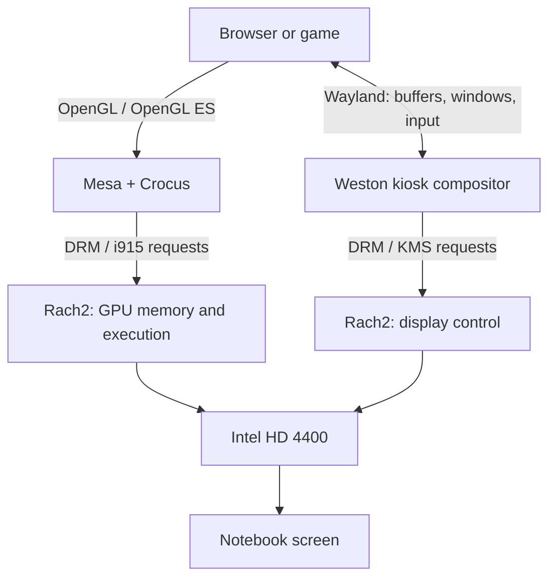
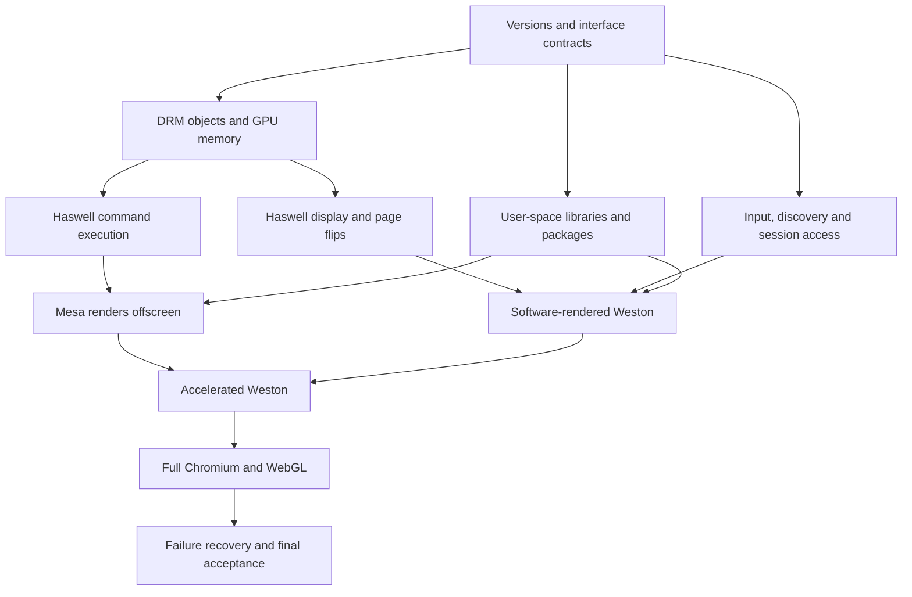
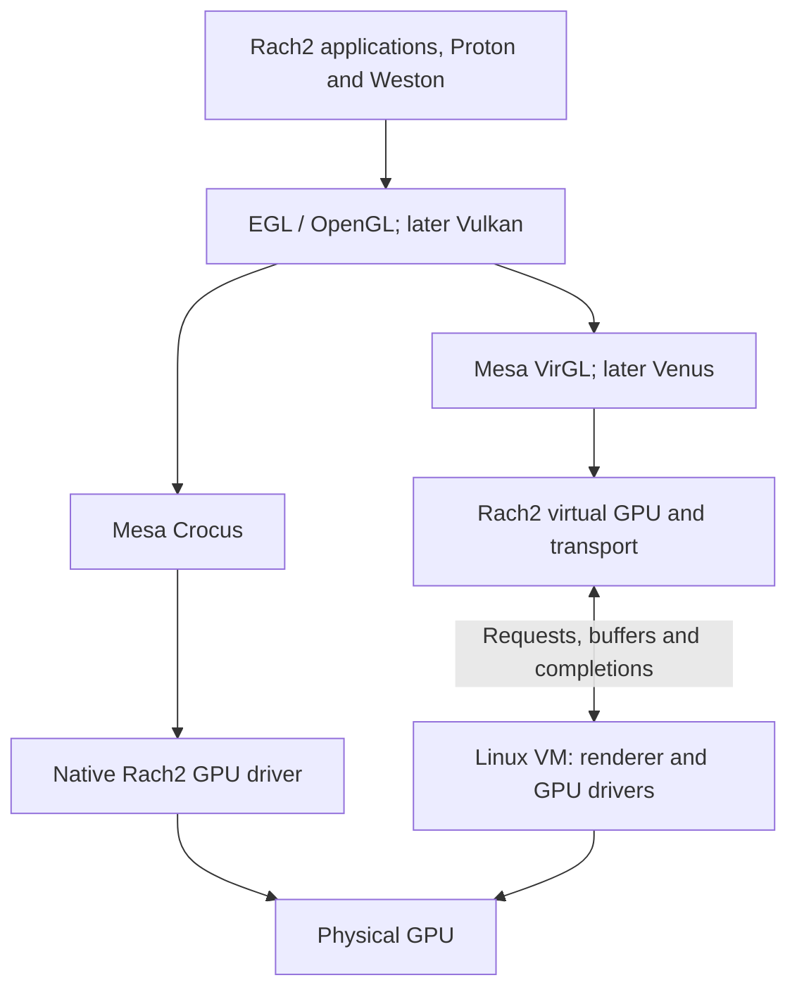

# The rach2-graphics thread with Codex

The owner's discussion of the graphics stack with Codex (gpt-6-astra) in the Codex thread "rach2-graphics", id 01a111bc-f616-7d90-871a-759b50e31da9, from its session file. Only the owner's and Codex's messages are kept; tool calls and the injected project rules are left out. Times are UTC+6.

## 2026-10-06 21:02 owner

<external_codex_apps_open_page>{"page_id":null}</external_codex_apps_open_page>

## 2026-10-06 21:02 owner

Can you rebuild your context here?

## 2026-10-06 21:02 Codex

I will read the project overview, recent commits, and current work state to recover the context.

## 2026-10-06 21:03 Codex

The tree has progressed through milestone 57: x86-64, UEFI, SMP, and NVMe. Recent commits fix delayed hardware watchpoints and serialize mutation runs. The working tree also has a broad, uncommitted change adding fault-text checks; I am checking the latest records to distinguish accepted work from work still in progress.

## 2026-10-06 21:04 Codex

Context rebuilt from the project rules, Readmes, milestone records, recent commits, and working diff.

* Rach2 now supports i686 and x86-64, BIOS and UEFI, SMP, NVMe, and the GNU userland. [Milestone 57](/Users/toksaitov/Desktop/rach2/dev-log/57-arch/Readme.md) records acceptance on October 5.
* Subsequent work fixed tmux console faults, then ptrace single stepping and delayed hardware watchpoints.
* HEAD is `68b8e028`, which adds shared locking for mutation scripts.
* The working tree has 97 modified files, chiefly adding `--texts` checks for stale mutation patterns. This work remains uncommitted.
* The milestone's deferred ptrace notes predate the recent fixes; they are not a reliable current task list.

I have the operating rules: no subagents or pushes, suites on the testing host, and code changes only when you request them. I changed no files and ran no tests.

## 2026-10-06 22:18 owner

This is not a task, just discovery discussion.

## 2026-10-06 22:18 Codex

Understood. This is discovery and discussion. I will use the recovered context to answer questions, without treating them as instructions to change the project.

## 2026-10-06 22:19 owner

Do you have info here about the Lenovo machine we use for testing?

## 2026-10-06 22:19 Codex

Yes. The [latest machine record](/Users/toksaitov/Desktop/rach2/dev-log/57-arch/Readme.md) describes:

* Lenovo G50-70, Intel Core i3-4030U, four logical processors, 16 GiB RAM.
* Samsung SSD 870 EVO on AHCI, with the ext2 root grown to 232.8 GiB.
* x86-64 Rach2 with the GNU userland, booted through GRUB by UEFI.
* Recorded address: `192.168.0.106`, accessible over SSH.
* SanDisk 3.2Gen1 USB stick used for installation and recovery.
* Tested hardware includes the framebuffer console, USB keyboard and mouse, RTL8168GU networking, and HD Audio.

The last recorded update installed build `00904d42` after the tmux console fixes on October 5. I have not checked its current state.

The Lenovo is the physical hardware test machine. Automated suites run on a separate Ubuntu/WSL2 host reached as `ssh testing`.

## 2026-10-06 22:20 owner

Our os is so solid, I am starting to wonder about graphics. Remind me which gpu that device has?

## 2026-10-06 22:20 Codex

I will check the Lenovo hardware record for its GPU.

## 2026-10-06 22:21 Codex

Intel HD Graphics 4400, integrated into its Core i3-4030U Haswell processor. That identification follows from our recorded CPU model and [Intel's specifications](https://www.intel.com/content/www/us/en/products/sku/81018/intel-core-i34030u-processor-3m-cache-1-90-ghz/specifications.html).

Rach2 currently draws its console into the firmware-provided 1366x768 framebuffer. It does not yet use the GPU's rendering acceleration.

## 2026-10-06 22:22 owner

How good open source drivers there are for Linux for that GPU?

## 2026-10-06 22:22 Codex

I will check the Linux and Mesa support for Haswell graphics.

## 2026-10-06 22:22 Codex

Linux has mature display and OpenGL drivers for it, and Intel publishes the hardware programming manuals. For Rach2, the main difficulty would be supplying the kernel services those drivers depend on.

## 2026-10-06 22:23 Codex

Very good for desktop graphics and OpenGL. The HD 4400 has mature open-source Linux support.

There are two main parts:

* Linux's `i915` kernel driver controls the display, manages GPU memory, and submits rendering commands. Its interfaces and implementation are extensively documented. [Kernel documentation](https://docs.kernel.org/gpu/i915.html)
* Mesa's `Crocus` driver supplies OpenGL for Haswell. It replaced the older `i965` OpenGL driver and still receives fixes in current Mesa releases. [Mesa's driver guidance](https://docs.mesa3d.org/amber.html), [2026 release notes](https://docs.mesa3d.org/relnotes/26.0.0.html)

Intel also publishes the Haswell programming manuals: registers, GPU commands, memory management, rendering, blitting, and display control. That is particularly useful for an operating system like ours. [Intel's manuals](https://www.intel.com/content/www/us/en/docs/graphics-for-linux/developer-reference/1-0/intel-core-processor-2013.html)

For Rach2, I would consider this a promising GPU to support. We have both hardware documentation and working driver source to study. Reusing Mesa would still require substantial kernel work: GPU buffers, mappings, command submission, and synchronization through the interfaces Mesa expects. Our Linux system-call compatibility helps with userspace, but those GPU interfaces would need their own implementation.

## 2026-10-06 22:25 owner

So it is doable to get gpu accelerated graphics, right?

## 2026-10-06 22:25 Codex

Yes. GPU-accelerated graphics on that Lenovo is a realistic goal for Rach2.

The substantial work is kernel support for GPU memory, command submission, synchronization, and recovery when the GPU hangs. With compatible interfaces in place, Mesa's Crocus driver could supply the OpenGL implementation and shader compiler.

The hardware documentation and working open-source drivers make this feasible. It would be a major milestone; a triangle rendered by the GPU and displayed on the screen would be the first useful proof.

## 2026-10-06 22:26 owner

Which OpenGL was the last that gpu had support for in mesa? What about Vulkan?

## 2026-10-06 22:26 Codex

I will check Mesa's Haswell-specific OpenGL and Vulkan limits.

## 2026-10-06 22:28 Codex

For the HD Graphics 4400, Mesa provides:

| API | Haswell support |
| --- | --- |
| OpenGL | 4.6 through Crocus |
| OpenGL ES | 3.2 through Crocus |
| Vulkan | Normally reports 1.2 through HASVK, but support is incomplete and non-conformant |

The OpenGL versions are recorded in [Mesa's feature list](https://gitlab.freedesktop.org/mesa/mesa/-/blob/main/docs/features.txt).

Vulkan needs that qualification: [HASVK's source](https://gitlab.freedesktop.org/mesa/mesa/-/blob/main/src/intel/vulkan_hasvk/anv_device.c) explicitly warns that Haswell support is incomplete and reports no conformance version. Its advertised API version does not guarantee correct support for every required feature.

For Rach2, I would target OpenGL first. Vulkan on this particular GPU would be experimental.

## 2026-10-06 22:36 owner

No other Vulkan version?

## 2026-10-06 22:36 Codex

Vulkan 1.0 and 1.1 applications can work too. **1.2 is the normal advertised maximum**, not the only version it accepts.

But if you mean an older version with complete, conformant support: Mesa does not claim one for Haswell. The [driver remains marked incomplete](https://gitlab.freedesktop.org/mesa/mesa/-/blob/main/src/intel/vulkan_hasvk/anv_device.c), even when an application requests an older API version. Some applications work; compatibility must be checked individually.

## 2026-10-06 22:40 owner

Now, the graphics part of Linux is so messy. DRI, Mesa, gpu drivers, gpu drivers in mesa, Wayland, X, tile managers, Gnome, GTK, … How it all relates? I am thinking about what to pick for my kernel. Currently, I will be fine with fullscreen games, or the browsers holding exclusively the whole notebook screen to themselves, one at a time, but the browser should have accelerated rendering and WebGLWebGL/GPU support.

## 2026-10-06 22:40 Codex

I will map the layers and check what Chromium and Firefox need for a fullscreen setup. I will also separate WebGL support from WebGPU, since Haswell's Vulkan limits matter there.

## 2026-10-06 22:41 Codex

A single fullscreen application can use a small Wayland compositor without GNOME or a tiling window manager. I am using the visualization skill for a compact diagram showing the separate rendering and display paths.

## 2026-10-06 22:43 Codex

The distinction that matters for the browser is clearer now: WebGL can use Mesa's OpenGL driver, while Chrome's usual Linux WebGPU path uses Vulkan. WebGPU also has an OpenGL ES compatibility mode, but its documented rollout began on Android; I would treat support on this Lenovo as a separate experiment.

## 2026-10-06 22:45 Codex

Your target fits a kiosk graphics stack: one fullscreen application, GPU rendering, and a small program managing the screen and input.

For Rach2, my provisional choice would be Mesa/Crocus, Wayland, and Weston's kiosk shell, with Linux-compatible graphics and input interfaces in the kernel. That would support a browser or game without requiring a complete desktop environment. WebGL is a realistic target; WebGPU needs a separate qualification on this GPU.

The names become easier to follow when separated by responsibility:

| Component | What it does |
| --- | --- |
| OpenGL, OpenGL ES, Vulkan | APIs through which applications request rendering and GPU computation. |
| Mesa | Userspace implementations of graphics APIs, including shader compilers and drivers for particular GPUs. |
| Crocus, HASVK | Mesa's Haswell drivers: Crocus implements OpenGL; HASVK implements Vulkan. |
| Kernel GPU driver, such as `i915` | Controls hardware, manages GPU memory and execution, handles interrupts, and recovers from hangs. |
| DRM | Direct Rendering Manager: Linux's kernel graphics framework and userspace interfaces. |
| KMS | Kernel Mode Setting: the display part, including resolutions, display outputs, and switching the displayed image buffer. |
| `libdrm` | A userspace library wrapping DRM interfaces. |
| DRI | Direct Rendering Infrastructure: the framework developed to let applications render directly through graphics drivers. Its pieces span Mesa, the kernel, and historically X. |
| EGL and GBM | EGL creates rendering contexts and connects rendering to windows or buffers. GBM allocates graphics buffers. |
| Wayland | A protocol between applications and a compositor for presenting buffers, receiving input, and managing windows. |
| X11 and Xorg | An alternative window-system protocol and its principal server implementation. |
| Window manager | Decides window placement, size, focus, and related policy. A tiling manager is one kind. Under Wayland, this role belongs to the compositor. |
| GNOME | A desktop environment: shell, settings, applications, and services. Its compositor is Mutter. |
| GTK, Qt | Libraries applications use to implement their interfaces. Using GTK does not require running GNOME. |

The distinction between the two kinds of GPU driver matters. Mesa's Crocus turns OpenGL operations and shaders into Haswell commands. The kernel driver provides the memory, execution, synchronization, and protection those commands require. They are cooperating parts of one implementation. [Mesa source overview](https://docs.mesa3d.org/sourcetree.html), [Linux i915 documentation](https://docs.kernel.org/gpu/i915.html)

DRI is mostly an architectural term you encounter in library names and documentation. It is not another server you must run beside Wayland. [DRI overview](https://dri.freedesktop.org/wiki/)

For the proposed Rach2 arrangement, the principal paths would look like this:



Rendering and presentation are distinct. The application renders into a buffer through Mesa. It tells the compositor which buffer to display. The compositor handles input and presentation, and may use the GPU itself to combine images. When conditions allow, it can arrange for the application's buffer to be displayed directly, called direct scanout. Application draw calls do not all pass through the compositor. [Wayland architecture](https://wayland.freedesktop.org/architecture.html)

A compositor remains useful even with one fullscreen application. Browsers have menus, permission dialogs, tooltips, cursors, and sometimes additional windows. Something must also handle keyboard focus and restore control when the application exits. Weston's kiosk shell already makes application windows fullscreen. Cage is another compositor designed specifically for this use. Neither requires GNOME or a tiling desktop. [Weston kiosk shell](https://wayland.pages.freedesktop.org/weston/toc/kiosk-shell.html), [Cage](https://github.com/cage-kiosk/cage)

It is possible to omit Wayland and let an application control DRM/KMS directly. That can suit a native game with an appropriate backend. Chromium also has a direct DRM/GBM backend associated with ChromeOS. However, using that would involve a particular browser build and platform integration. I would favor the ordinary Wayland interface for supporting browsers and games from different projects. [Chromium's platform interfaces](https://chromium.googlesource.com/chromium/src/+/main/docs/ozone_overview.md)

For the browser, there are several separate capabilities:

* Accelerated page rendering and composition: drawing page content, scrolling, transforms, and combining layers. An OpenGL path can provide this.
* WebGL 1 and 2: graphics APIs exposed to web pages. Chromium's ANGLE layer can translate these operations to OpenGL, then Mesa/Crocus drives the HD 4400. Vulkan is not required for this path. [ANGLE documentation](https://chromium.googlesource.com/angle/angle/)
* WebGPU: a different API with different requirements. Chrome's documented Linux path uses Vulkan. Haswell's incomplete Vulkan implementation makes this uncertain. There is now a restricted WebGPU compatibility mode using OpenGL ES 3.1, but its documented rollout began on Android and applications must opt into it. It is a possible avenue to investigate, not a capability we should promise merely because Crocus supports OpenGL 4.6. [Linux WebGPU](https://developer.chrome.com/blog/new-in-webgpu-144), [compatibility mode](https://developer.chrome.com/blog/new-in-webgpu-146)

Hardware video decoding is another independent capability; accelerated WebGL does not automatically provide it.

The important kernel decision is which userspace interfaces to support. I would investigate the DRM/KMS and `i915` interfaces required by a chosen Mesa release, together with buffer sharing, synchronization, and Linux-style input events. That would let existing libraries retain their platform code. Rach2 could keep its own internal design, but the exposed behavior would have to match what those libraries expect. Linux explicitly separates access for rendering from privileged display control. [DRM userspace interfaces](https://docs.kernel.org/gpu/drm-uapi.html)

One existing limitation also matters: our current browser package is [`chromium-headless-shell`](/Users/toksaitov/Desktop/rach2/vendor/gnu/chromium/Readme.md). Its successful runs establish useful process, library, and sandbox support. A visible accelerated browser would additionally need the full browser build and the graphics path described above.

## 2026-10-06 23:00 owner

I think, dropping WebGPU and Vulkan is a logical first step, right?

## 2026-10-06 23:01 Codex

Yes. I would defer Vulkan and WebGPU and make the first graphics target:

* OpenGL and OpenGL ES through Mesa's Crocus driver.
* A fullscreen Wayland compositor.
* GPU-accelerated browser rendering and WebGL 1/2.
* Native games that use OpenGL or OpenGL ES.

That fits the Lenovo's Haswell GPU and avoids depending on its incomplete Vulkan support. Vulkan-only games and WebGPU-only applications would be outside the initial scope.

The substantial kernel work remains: GPU memory management, command submission, synchronization, display control and recovery after a GPU hang. Those foundations also serve a later Vulkan implementation, so deferring it does not require choosing a dead-end architecture.

## 2026-10-06 23:04 owner

I also would love to keep a Linux-like DRM/… interface to limit porting burden for apps. Tell me more about Weston. What is that?

## 2026-10-06 23:04 Codex

I'll check Weston's documentation and explain how it fits with a Linux-compatible graphics interface in Rach2.

## 2026-10-06 23:05 Codex

Weston is a Wayland display server and compositor. It runs in user space, accepts connections from graphical applications, displays their windows, and delivers keyboard, mouse and touch events. Wayland defines the communication protocol; Weston implements the server side. It can provide a basic desktop or a specialized environment such as a kiosk. [Weston overview](https://wayland.pages.freedesktop.org/weston/index.html)

For Rach2, its useful feature is the separation of three choices:

| Part | Responsibility | Likely choice |
|---|---|---|
| Backend | Connects to the display and input devices | DRM/KMS backend |
| Renderer | Combines application images when needed | OpenGL ES through Mesa |
| Shell | Decides window placement and focus | `kiosk-shell` |

Weston's DRM backend runs directly on the kernel graphics interfaces. Its OpenGL ES renderer provides accelerated composition; its Pixman renderer provides software composition, which could help during initial development. Vulkan is optional. [Backend and renderer documentation](https://wayland.pages.freedesktop.org/weston/toc/running-weston.html)

The word *shell* here means window-management policy. Weston's `kiosk-shell` makes top-level application windows fullscreen. That closely matches your browser-or-game use case. It does not itself enforce that only one application process exists; your launcher would decide which application runs and what happens when it exits. [Kiosk shell documentation](https://wayland.pages.freedesktop.org/weston/toc/kiosk-shell.html)

When a browser draws a frame, two paths are involved:

1. The browser uses Mesa to render into a GPU buffer.
2. It submits that buffer to Weston through Wayland.
3. Weston arranges the application image, any popups and the cursor.
4. Weston asks the kernel to present the resulting image on the display.

The browser's OpenGL drawing commands go through Mesa to the GPU. Weston receives the resulting image and manages its presentation. [Wayland architecture](https://wayland.freedesktop.org/architecture.html)

Your Linux-interface preference fits this well. I would aim for Linux ABI compatibility at the graphics boundary: the device files, `ioctl` structures, memory mappings, events and behavior that existing libraries expect. The main parts would be:

* DRM/KMS for display resources, modes and frame presentation.
* The Intel `i915` rendering interface needed by the chosen Mesa driver.
* Buffer sharing and synchronization between the application and Weston.
* Separate primary and render devices, conventionally `/dev/dri/card0` and `/dev/dri/renderD128`.

DRM includes both common interfaces and driver-specific interfaces. Matching the common DRM interface alone would therefore leave part of Mesa's requirements unimplemented. Rach2 can implement these contracts using its own kernel structures. [DRM userspace interfaces](https://docs.kernel.org/gpu/drm-uapi.html)

There is some supporting work beyond graphics. Weston needs device discovery and controlled access to display and input devices. Its input library, libinput, expects Linux evdev devices and device metadata. Those interfaces need compatibility support or small, deliberate adaptations. A full systemd installation is optional: Weston also supports device access through libseat and seatd. [Libinput architecture](https://wayland.freedesktop.org/libinput/doc/latest/architecture.html), [Weston startup](https://wayland.pages.freedesktop.org/weston/toc/running-weston.html)

I would start with the existing Weston executable and kiosk shell. Its `libweston` library also permits a custom compositor later, but the supplied program already gives you a concrete application against which to develop and test the kernel interfaces.

## 2026-10-06 23:26 owner

Can you estimate how much time it may take in LLM hours for models like Opus 5.5 Medium, 6.1 sol medium, and Astra Reviewer at the integration level of major part end if we can start as many subagents as we need? How much can we parallelize the work, what is the hypothetical order (thus blocking dependencies)?

## 2026-10-06 23:26 Codex

I'll inspect the graphics and input code already in Rach2, then estimate the work, parallelism and dependencies. I'll treat unlimited subagents as a hypothetical; the repository's current agent limits still apply to actual work.

## 2026-10-06 23:26 Codex

Rach2 already has much of the Unix support this stack needs, including shared memory and file-descriptor passing. The large missing part is the GPU driver and its DRM interface. I'm also using the OpenAI Docs skill to check the named models; any hour estimates will be planning estimates, not measured model performance.

## 2026-10-06 23:28 Codex

The main dependency is GPU memory and command execution. Mesa can be prepared in parallel, but accelerated Weston and Chromium need that driver to work on the Lenovo. Input, device discovery, packaging and test tools can also proceed independently. The hour range needs to allow for hardware faults that appear only after integration.

## 2026-10-06 23:29 owner

Remember, the goal is to find the sweat spot for the number of agents, limit consumption, and speed.

## 2026-10-06 23:29 Codex

Understood. I'll compare total agent-hours with elapsed time. My provisional choice is three implementation agents plus one integrator, with Astra used at major integration reviews. Extra agents would need an independent task with settled interfaces to justify their cost.

## 2026-10-06 23:30 Codex

The likely sweet spot is three implementation agents plus one integrator, with one Astra reviewer used at major integration boundaries. Start with fewer agents, increase to four while independent work exists, then reduce again during hardware integration.

For that arrangement, I would provisionally budget:

| Measure | Planning estimate |
|---|---:|
| Implementation, integration, tests and fixes | 350-800 agent-hours |
| Astra reviews and focused follow-up reviews | 40-100 agent-hours |
| Total | About 400-900 agent-hours |
| Elapsed time with useful parallel work | About 200-450 hours |

An agent-hour means one agent working for one hour. Four agents working for ten hours consume forty agent-hours. These are low-confidence engineering estimates, not measured model benchmarks. I would use roughly 600 aggregate hours as the initial budget, then revise it after the first hardware results.

This assumes x86_64 first, the Lenovo's Haswell GPU and internal panel, Linux-compatible graphics interfaces, Mesa Crocus, Weston kiosk mode, and full Chromium with accelerated rendering and WebGL 1/2. External displays, suspend/resume, video decoding acceleration, Vulkan and WebGPU would need separate estimates.

Rach2 already supplies shared memory, file-descriptor passing, threads and much of the required Linux system-call interface. Its current [graphics interface](/Users/toksaitov/Desktop/rach2/rach2/sys/display/fb.h) and [input interface](/Users/toksaitov/Desktop/rach2/rach2/sys/input.h) are much narrower than DRM/KMS and evdev. Most of the uncertainty is in the new kernel GPU work.

The approximate division is:

| Work | Implementation agent-hours |
|---|---:|
| Select versions, inspect required interfaces, define contracts | 20-40 |
| DRM objects, GPU buffers, mappings, sharing and synchronization | 50-100 |
| Haswell display control and frame presentation | 60-140 |
| Haswell command execution, isolation, completion and reset | 90-220 |
| evdev input, device discovery and session ownership | 25-60 |
| Mesa, Wayland, Weston and full Chromium packaging | 30-75 |
| Integrated browser operation, failure tests and fixes | 60-160 |

The ranges include implementation fixes. Astra's review time is separate. A hardware fault that requires substantial redesign could exceed the upper estimate.

The blocking dependencies would look approximately like this. Arrows indicate what must work before the next integrated result can be demonstrated; coding can overlap once the interfaces are agreed.



Offscreen rendering is useful here: we can prove GPU execution without waiting for the display driver. Conversely, software-rendered Weston can prove display, input and Wayland operation before GPU rendering works. Those two results make later integration failures easier to locate.

I would vary the team by stage:

| Stage | Useful active team |
|---|---|
| Initial investigation and contracts | One lead, one investigator |
| Independent implementation | Three workers, one integrator |
| Hardware and Mesa integration | One driver owner, one user-space owner, integrator |
| Browser integration and final fixes | Two implementers, Astra at review boundaries |

During the widest stage, the workers would own display, rendering, and input/user-space integration. The integrator would own shared kernel interfaces, resolve cross-component changes and maintain the combined tree. Workers could prepare tests and documentation within their components.

Four agents will probably provide about twice to three times the useful throughput of one agent. I would not budget for a fourfold improvement. Shared memory lifetimes, synchronization and device ownership require coordinated decisions. The single Lenovo also serializes hardware experiments. Six or eight implementation agents would likely increase total consumption before producing a comparable reduction in elapsed time.

For the models, I would use this allocation:

* GPT-6.1 Sol Medium for bounded implementation work with settled interfaces.
* Opus 5.5 Medium for the integration owner if it already has the strongest project context. Otherwise, there is no measured basis here for preferring it over Sol.
* Astra xhigh for reviews of the complete integrated changes, with focused reviews after fixes.

The official documentation supports these models' intended roles and effort settings, but supplies no reliable conversion into hours for this project. I would assign Opus Medium and Sol Medium the same initial implementation budget. A mixed team divides that budget between them. [OpenAI Sol documentation](https://developers.openai.com/api/docs/models/gpt-6.1-sol), [Opus documentation](https://platform.claude.com/docs/en/models/opus-5-5/overview), [Astra documentation](https://developers.openai.com/api/docs/models/gpt-6-astra)

I would schedule four major reviews: the kernel interface foundations, working software Weston, accelerated Weston, and the complete browser integration. Each review needs an observable result and tests, including failures and cleanup.

To control consumption, each worker should receive a bounded contract, its owning files and a completion condition. One agent should own each shared interface. Stop agents when their work becomes blocked, and give the reviewer concrete invariants and evidence. After the first native page flip and the first Crocus-rendered image, we would have enough project-specific evidence to replace much of this estimate.

## 2026-10-06 23:36 owner

Fanout with sonnet-like models make sense, or just waste of limit, time, and effort?

## 2026-10-06 23:36 Codex

I'll distinguish work that can be delegated cheaply from work where coordination and rework could erase the savings, and check the current Sonnet guidance.

## 2026-10-06 23:37 Codex

Yes, selective use makes sense. For this graphics project, I would use one or two Sonnet-class helpers for bounded work. Broad fanout would probably spend more on coordination and corrections than it saves.

The useful distinction is how independently the result can be produced and checked:

| Task | My initial assignment |
|---|---|
| Inventory Mesa's required ioctls, with source references | Sonnet helper |
| Package dependencies and build integration | Sonnet helper |
| Implement a small operation against an agreed contract | Sonnet helper |
| Write tests with specified expected behavior and mutations | Sonnet helper |
| Design GPU memory ownership and synchronization | Main kernel implementer |
| Diagnose hardware hangs across kernel and Mesa | Main kernel implementer |
| Review the integrated result | Astra |

Sonnet can do substantial coding. Anthropic recommends Medium for well-specified agentic tasks and higher effort for harder ones. The task definition matters more than treating it as a model for trivial work. [Sonnet guidance](https://platform.claude.com/docs/en/build-with-claude/prompt-engineering/prompting-claude-sonnet-5-5)

For your consumption goal, I would refine the team to:

* One Opus/Sol lead who also implements and integrates.
* One Opus/Sol worker on the other major kernel component.
* One Sonnet helper on a separate, well-defined task.
* A second Sonnet helper only while another independent task is ready.
* Astra at the agreed integration reviews.

That means three active implementers normally, four during useful parallel work. Helpers replace some of the earlier proposed workers; they are not an additional permanent group.

The cost to measure is:

`worker usage + briefing + review + corrections + integration`

A cheap worker that requires the lead to reconstruct its reasoning and rewrite its patch may cost more overall. A helper that returns a correct dependency manifest while the lead diagnoses GPU execution can save both time and consumption.

I would judge the first few real assignments by accepted work, lead time spent correcting them, and actual usage. API token prices alone do not tell us how much of your subscription allowance a task consumes. Increase helper count only when accepted work arrives faster than the lead can produce it without creating an integration backlog.

For Rach2, my starting recommendation is two main implementers and one Sonnet helper. Four concurrent implementers is a provisional ceiling, not a target to keep filled.

## 2026-10-06 23:41 owner

With parallelism, best case scenario, estimate in human hours?

## 2026-10-06 23:41 Codex

If you mean elapsed clock time, my optimistic estimate is about 200 hours, roughly eight days of nearly continuous agent work, for the complete reviewed stack: DRM/KMS, Mesa acceleration, Weston, and Chromium with WebGL.

That assumes:

* Three or four agents have useful independent work.
* The Lenovo and testing host are available when needed.
* No major driver redesign or prolonged GPU-hang investigation.
* Model limits do not interrupt progress.

I would still plan for 200-450 elapsed hours. More agents probably would not shorten the hardware and integration work much.

These are clock hours, not hours of your personal attention. The estimate remains speculative until the first display and GPU execution tests work.

## 2026-10-07 00:31 owner

Good. Now, let’s consider that we succeeded. Do a research run, how hard would it be after that to port Proton to our os. Hypothetically, of course.

## 2026-10-07 00:32 Codex

I'll research Proton's dependencies and compare them with the hypothetical Rach2 graphics stack. I'll distinguish running some Windows games from supporting current Proton broadly, since those are different porting targets.

## 2026-10-07 00:32 Codex

Proton has an OpenGL fallback for Direct3D 9-11, so dropping Vulkan still leaves a possible route for some Windows games. I also found a Rach2-specific obstacle: its x86_64 kernel deliberately disables 32-bit execution mode, which needs investigation for older games and Wine's WoW64 support.

## 2026-10-07 00:34 Codex

Wine's new WoW64 mode can reduce the need for 32-bit Unix libraries, but it still executes 32-bit x86 code. Proton's Wine source expects a code segment that Rach2 currently leaves absent. Steam adds a separate compatibility task: Valve still documents both 32-bit and 64-bit runtime libraries, and its container launcher has further kernel requirements.

## 2026-10-07 00:35 Codex

The distinction is clearer now. A Wine-based port for a tested set of older games looks feasible after the graphics work. Broad Proton support remains limited by the Lenovo's Vulkan support. Steam integration would also need work beyond Wine, particularly 32-bit Linux compatibility, audio and runtime containers.

## 2026-10-07 00:36 Codex

After the graphics milestone, running selected Windows games looks feasible. I would treat it as another major compatibility milestone. Broad modern Proton support would exceed the OpenGL-only Haswell target.

Proton combines Wine's Windows API implementation with graphics translation, media components, game-specific fixes and Steam integration. Most of that code could be reused. Our work would concentrate on the Linux interfaces and CPU behavior those components expect. [Proton repository](https://github.com/ValveSoftware/Proton)

The graphics restriction is substantial, but it does leave a useful path:

| Windows game's graphics API | Available route | Assessment |
|---|---|---|
| OpenGL | Wine through Mesa | Best initial target |
| Direct3D 9 | WineD3D translates to OpenGL | Plausible for selected older games |
| Direct3D 10/11 | WineD3D translates to OpenGL | Possible, with compatibility and performance limits |
| Direct3D 12 | vkd3d-proton translates to Vulkan | Outside our proposed stack |
| Vulkan | Wine forwards to a host Vulkan driver | Outside our proposed stack |

Proton explicitly supports `PROTON_USE_WINED3D=1` for its OpenGL route for Direct3D 9-11. Thus, omitting Vulkan does not prevent all Proton-derived gaming. [Proton configuration](https://github.com/ValveSoftware/Proton#runtime-config-options)

However, current DXVK 3.x targets Vulkan 1.4 and specific additional capabilities; vkd3d-proton requires Vulkan 1.3 plus substantial features. Mesa still describes Haswell Vulkan support as incomplete. Adding its existing Vulkan driver would therefore not give this Lenovo the usual modern Proton capabilities. [DXVK requirements](https://github.com/doitsujin/dxvk/wiki/Driver-support), [vkd3d-proton requirements](https://github.com/HansKristian-Work/vkd3d-proton#drivers), [Mesa Haswell driver](https://gitlab.freedesktop.org/mesa/mesa/-/blob/main/src/intel/vulkan_hasvk/anv_device.c)

I found four significant areas beyond graphics.

1. **32-bit execution is a concrete kernel gap.** Rach2's x86_64 kernel deliberately omits the 32-bit user code segment and the `int 0x80` entry. Proton's Wine source expects that segment and uses `int 0x80` for 32-bit thread-local storage setup. Supporting separate i686 and x86_64 builds does not provide mixed execution within one running kernel. This requires work on CPU mode transitions, TLS, exceptions and signal return. [Rach2 CPU layout](/Users/toksaitov/Desktop/rach2/rach2/sys/arch/x86_64/percpu.h:19), [Rach2 interrupt entry](/Users/toksaitov/Desktop/rach2/rach2/sys/arch/x86_64/idt.c:65), [Wine implementation](https://github.com/ValveSoftware/wine/blob/proton_11.0/dlls/ntdll/unix/signal_x86_64.c)

   Wine's new WoW64 architecture reduces the need for 32-bit Unix libraries, but still executes 32-bit Windows machine code. It helps the port without eliminating this kernel work. [Wine 11 release notes](https://github.com/ValveSoftware/wine/blob/proton_11.0/ANNOUNCE.md)

2. **Wine would exercise kernel behavior beyond Chromium.** Its exception handling, memory reservations, thread contexts and synchronization need close Linux compatibility. Existing signals, shared memory, sockets and futexes provide a foundation, but passing browser tests does not establish Wine compatibility. These are areas to validate, rather than confirmed missing implementations.

   Faster synchronization can come later. Wine uses NTSYNC when available; initial work can use its ordinary synchronization path. Implementing every optimization before the first game would increase the initial burden. [NTSYNC interface](https://docs.kernel.org/userspace-api/ntsync.html)

3. **Sound still needs a standard user-space interface.** Rach2 has working HDA hardware support, but exposes PCM through its own console ioctls. Unless the browser milestone also adds standard audio support, Wine needs an audio backend or an ALSA/PulseAudio-compatible path. Game controllers and video playback introduce further dependencies. [Current audio interface](/Users/toksaitov/Desktop/rach2/rach2/sys/audio/Readme.md)

4. **Steam is a separate integration task.** Valve documents both 32-bit and 64-bit glibc and graphics libraries for the Linux client. Wine's new WoW64 mode does not satisfy those independent requirements. Steam's runtime also uses container machinery and makes assumptions about namespaces, mounts, filesystem layout and audio. Rach2 already implements some relevant facilities, but their adequacy would need testing. Depending on the selected client and launchers, Xwayland may also enter the scope. [Steam requirements](https://github.com/ValveSoftware/steam-for-linux#hardware-and-software-requirements), [Runtime requirements](https://github.com/ValveSoftware/steam-runtime/blob/master/doc/steamlinuxruntime-known-issues.md)

For an economical approach, I would use this order:

1. Start Wine and its server, then run a 64-bit Windows console program.
2. Run a 64-bit Windows OpenGL program through native Wayland.
3. Add sound and prove one game through repeated launch, play, save and exit.
4. Implement the mixed-mode CPU support and test 32-bit Windows programs.
5. Establish a small collection of Direct3D 9 games through WineD3D.
6. Add the needed Proton components and game fixes.
7. Attempt Steam client and runtime integration as a separate batch.

Wine already has an OpenGL implementation for its Wayland driver, so the first graphical steps can reuse Weston directly. [Wine Wayland OpenGL implementation](https://github.com/ValveSoftware/wine/blob/proton_11.0/dlls/winewayland.drv/opengl.c)

Using the small parallel team we discussed, my provisional estimates would be:

| Result | Additional elapsed hours after graphics works |
|---|---:|
| First selected 64-bit Windows game | 40-100 |
| Tested collection of older 32-bit and 64-bit games, with sound | 150-350 |
| Steam integration plus that collection | 300-700 |

These are cumulative planning ranges, not measured porting times. The first Wine startup and exception tests could change them considerably. CPU compatibility and integration would limit parallelism; packaging, audio and test preparation could proceed alongside them.

I would make the acceptance target a named collection of games. A general promise that “Proton works” would be difficult to establish: even on supported Linux systems, anti-cheat and other game-specific restrictions remain, and Valve does not support kernel-space anti-cheat through Proton. [Valve compatibility guidance](https://partner.steamgames.com/doc/steamhardware/proton?l=english)

## 2026-10-07 00:45 owner

Sure, just a selection of old classic games, a small list probably.

## 2026-10-07 00:46 Codex

That makes the target much more manageable. I would define success as three to five named games, each with working graphics, sound, input, saves and loading.

For suitable older titles, Wine with OpenGL and WineD3D could be enough. Proton-specific components would follow where a chosen game needs them. Steam could remain a separate project.

The shared kernel work still matters. Many classics are 32-bit, so mixed 32/64-bit execution would probably become an early requirement. A short list reduces the compatibility work after that foundation exists.

Which classics do you have in mind? The original release versus a remaster, and the store edition, can change the requirements considerably.

## 2026-10-07 00:55 owner

I know it is crazy, but it is a classic at this point, an original Crysis, even on the lowest lo-res settings. I remember it worked with dx 9 first.

## 2026-10-07 00:55 Codex

I will check the original Crysis requirements and its Wine rendering path against the Lenovo's Haswell graphics.

## 2026-10-07 00:56 Codex

Yes. Original Crysis is a plausible, demanding target for this plan. Your memory is right: it has a Direct3D 9 renderer, selected with `-dx9`. Vulkan is unnecessary for that path. [C1-Launcher documentation](https://github.com/ccomrade/c1-launcher#command-line-parameters)

The intended rendering chain would be:

`Crysis DX9 -> WineD3D -> OpenGL -> Mesa Crocus -> Intel HD 4400`

Proton explicitly supports this OpenGL route for Direct3D 9 through WineD3D. Whether Crysis renders correctly and runs fast enough on our port would still need testing. [Proton documentation](https://github.com/ValveSoftware/Proton#runtime-config-options)

The hardware evidence is encouraging. Notebookcheck recorded Crysis GPU benchmark results of 21 and 42.5 FPS at 1024x768, low settings, on two HD 4400 laptops. One also managed 40 FPS at 800x600. These are measurements from other systems, with i5 processors, so they establish plausibility rather than predict Rach2 performance. [HD 4400 benchmarks](https://www.notebookcheck.net/Intel-HD-Graphics-4400.91979.0.html)

There is another useful detail: original Crysis has a 64-bit build. The GOG edition includes it, and GOG requires neither activation nor its Galaxy client. That makes it a candidate for starting with 64-bit Wine and potentially postponing mixed 32/64-bit execution support. [Supported editions](https://github.com/ccomrade/c1-launcher#where-to-get-the-game), [GOG edition](https://www.gog.com/en/game/crysis)

Before committing substantial work specifically to Crysis, I would measure that exact edition on the Lenovo under Linux, using WineD3D and Mesa Crocus at 800x600, low settings, without antialiasing. That would answer whether the proposed graphics path is already fast enough on this hardware.

For Rach2, a concrete eventual target could be: load a campaign level, play through combat with sound and mouse input, save and reload, and sustain roughly 25-30 FPS in a repeatable scene. That is ambitious enough to be meaningful, and narrow enough to investigate.

## 2026-10-07 00:58 owner

I want Proton with OpenGL, so we can start work on this notebook, but continue on something with Vulkan support. The old Lenovo is a test bad to justify investment in better test hardware to prove that things are possible

## 2026-10-07 00:59 Codex

Understood. The target is Proton on Rach2, with OpenGL as its first rendering backend. The Lenovo establishes that the OS can support the stack and run a substantial Windows game.

That changes the proposed scope:

* Keep a pinned Proton release, its Wine changes and its runtime requirements as the basis.
* Start with Proton's existing WineD3D OpenGL option on the Lenovo.
* Build reusable support for processes, memory, synchronization, sound, input and graphics buffers.
* On later hardware, add the appropriate kernel GPU driver and Mesa Vulkan driver, then enable DXVK and eventually vkd3d-proton.

The later Vulkan work would still be substantial. A different GPU needs working kernel and userspace drivers before changing Proton's renderer helps. But the Windows compatibility work and much of the surrounding graphics infrastructure would remain useful.

Crysis then becomes a concrete demonstration: Rach2 boots on real hardware, runs Proton, renders through an accelerated GPU driver, and supports sustained gameplay with sound, input and saved games. Its frame rate would show what this machine can achieve; correctness and stability would demonstrate what the OS can support.

I would therefore treat OpenGL as the first supported path, and preserve the architecture needed for Vulkan from the start. The Lenovo does not need to satisfy the final performance target to justify the next machine.

## 2026-10-08 13:22 owner

<external_codex_apps_open_page>{"page_id":null}</external_codex_apps_open_page>

## 2026-10-08 13:22 owner

By the way, aside from building Rach2 as an educational project, I was also planning to use it as a research sandbox for experiments, and to publish any that produced good results. One of my ideas was to help the hobby OS development community cope with the complexity of writing network and GPU drivers. The plan went roughly like this. First, add KVM-like virtualization support to the kernel, exposing a similar interface. Next, run a lightweight VMM on top of it, something like Amazon's Firecracker but of our own making (or simply QEMU, if we can trim it down enough for our purposes). That VMM would host a stripped-down Linux guest with the drivers the machine needs for things like networking and graphics (real GPU drivers, such as the official NVIDIA or AMD ones), maybe also our injections to do fast comms with our kernel to pass data or safely share it in a synchronized way. Then give the VM direct control over the I/O and memory ranges of the devices we want to hand off, so that its drivers can talk to the hardware directly in the VMM, while our kernel relinquishes its own access to them. Finally, expose what those drivers provide through some standardized interface on the kernel side, or plug it into our network or graphics stack somehow, so that users can consume the results. It is like a weird Linux as as a microkernel service, so that people can focus on their unique hobby kernel ideas, instead of fighting with accelerated drivers for graphics, network, or even other devices in the future. At the beginning, I would prefer to limit the scope to just one type of a device, preferably a GPU. To make it easier to have some baseline, I want first, to have a native GPU stack in this kernel as per our discussion, but I want it to be built in such a way, that after all the DRM/DRI, Wayland, Wine, Proton work, we can actually do the experiment like that and plug it with the least amount of interface adjustments avoid full kernel reengineering. What do you think?

## 2026-10-08 13:22 Codex

I will check the closest existing designs and the interfaces this would need. The key question is how Linux can provide GPU services to Rach2 clients while keeping the native graphics stack reusable.

## 2026-10-08 13:23 Codex

The design has established precedents in driver VMs and virtual GPU protocols. The main choice is where to divide the GPU stack. Forwarding Intel's DRM calls would remain tied to Intel; a virtual GPU protocol could let Rach2 keep its applications while Linux supplies a different hardware driver.

## 2026-10-08 13:25 Codex

The Lenovo's CPU is listed with VT-x, EPT and VT-d support, but its firmware and integrated GPU still need a passthrough check. Shared buffers and synchronization also need explicit contracts: a Linux dma-buf file descriptor cannot be used directly by Rach2. Those are the parts worth designing into the native stack now.

## 2026-10-08 13:29 Codex

I think this is a sound research direction, and it should influence the native graphics design now. Rach2 could remain a monolithic kernel while using a Linux VM as a device service. The substantial additions would be virtualization, device assignment and communication between the two kernels.

The architecture has precedents. Xen supports driver domains, and seL4 explicitly describes running Linux drivers in a VM alongside native components. Genode provides another useful comparison: it reuses Linux driver code inside isolated components. Your research contribution could be a practical implementation for small operating systems, with a documented interface and measured costs. [Xen](https://xenproject.org/projects/hypervisor/), [seL4](https://sel4.systems/About/how-to-use.html), [Genode](https://www.genode.org/documentation/components)

The most consequential decision is where to divide the graphics stack.

For the experiment you describe, I would put the hardware-specific userspace driver inside Linux as well as the kernel driver. Shader compilation, GPU command construction and resource management extend across both. Rach2 would consume a virtual GPU service through an interface designed for that purpose.

VirGL is a strong starting candidate for OpenGL; Venus provides a later Vulkan path. These already provide protocols and implementations for sending graphics work to a renderer elsewhere. They deserve evaluation before inventing a new graphics protocol. [QEMU's graphics architecture](https://www.qemu.org/docs/master/system/devices/virtio/virtio-gpu.html), [Mesa Venus](https://docs.mesa3d.org/drivers/venus.html)

Conceptually, the two configurations would look like this. They are alternatives selected at boot:



Applications, Proton and the compositor would continue to execute on Rach2. Linux would supply graphics services.

There is an important implementation qualification: ordinary virtio-gpu puts the application in a guest and the renderer on its host. Your arrangement reverses those roles. The protocols and renderer code remain useful, but connecting a Rach2 frontend to a backend inside its Linux guest requires a transport and memory-sharing implementation. It is not an existing QEMU command-line configuration.

DRM compatibility alone would not provide that portability. DRM has common interfaces, but Intel, AMD and other drivers also expose hardware-specific commands. A native Crocus backend expects Intel facilities; it cannot use an AMD driver merely because both expose DRM.

The reusable boundaries should therefore be:

* The application APIs: OpenGL, EGL and later Vulkan.
* The Wayland protocol between applications and the compositor.
* The common display, buffer-sharing and synchronization contracts.
* A virtual GPU protocol for the Linux service configuration.

Switching configurations would select a different Mesa backend and kernel graphics device. The objective would be to preserve application code and most compositor code.

Display ownership needs its own design. Once Linux owns the entire GPU, it also owns the hardware that sends pixels to the panel. Rach2 cannot continue using its native display driver or writing the old firmware framebuffer independently.

To keep Weston on Rach2, I would expose a virtual display device there. Its presentation requests would reach a small Linux service that performs the actual display updates. Implementing the relevant KMS contract could preserve Weston's DRM backend; otherwise, the adjustment should remain confined to a compositor backend. This presentation path is additional work beyond forwarding rendering commands.

For the native stack, I would establish these contracts from the beginning:

* Buffers have handles, sizes, access rights and explicit lifetimes. Physical addresses and driver-private pointers stay inside their owning implementation.
* Rendering submission is asynchronous. Completion is represented by a fence, an object that reports when work has finished or failed.
* Buffer descriptions include format, dimensions, stride and memory layout. A buffer suitable for rendering is not automatically suitable for display.
* Device loss has defined behavior. Pending operations complete with an error, resources become invalid, and clients can recreate their state.
* Physical devices have one owner. Ownership includes register mappings, interrupts, DMA mappings and any console access.

These are useful requirements for the native implementation itself. They do not require implementing the future VM transport immediately.

Shared memory deserves particular care. A Linux dma-buf file descriptor refers to an object managed by the Linux kernel; Rach2 cannot use that descriptor directly. The bridge must establish corresponding objects in both systems and control which pages each can access. Synchronization must cover CPU access, GPU access and eventual page reuse. Existing dma-buf and vhost-user mechanisms provide useful models, but their file-descriptor passing does not by itself cross a VM boundary. [Linux buffer sharing](https://docs.kernel.org/driver-api/dma-buf.html), [vhost-user GPU protocol](https://www.qemu.org/docs/master/interop/vhost-user-gpu.html)

I would permit copying in the first working prototype. Then measure and remove particular copies. Shared memory alone does not establish that a path avoids copies: the renderer or display driver may still move or convert the image.

Your device-assignment proposal also needs more than relinquishing I/O ranges. CPU virtualization protects memory accessed by the guest CPU. A GPU accesses memory through DMA, which requires separate protection.

Rach2 would need IOMMU management, controlled interrupt routing, PCI configuration handling, device ownership checks and a workable reset procedure. Devices that cannot be isolated independently may have to be assigned together. These are the responsibilities Linux exposes through VFIO and related interfaces; implementing a KVM-compatible CPU interface would not supply them automatically. [VFIO documentation](https://kernel.org/doc/html/latest/driver-api/vfio.html)

There is also one immediate Rach2 design constraint: its global kernel lock must not remain held while a guest vCPU executes or while a caller waits for the Linux graphics service. Otherwise the service could prevent the host from doing the work needed to complete its request.

For the VMM, I would initially favor QEMU with a deliberately limited configuration. Its existing device-assignment and Intel graphics handling are valuable reference implementations. A smaller VMM could follow once the experiment establishes exactly which facilities it needs. If compatibility with QEMU is the aim, implement the actual KVM operations and capability negotiation required by that configuration, rather than an interface that merely resembles KVM. [KVM API](https://docs.kernel.org/virt/kvm/api.html)

The Lenovo remains useful, although its suitability for GPU assignment is unproven. Intel lists its i3-4030U as supporting VT-x, EPT and VT-d. We still need to verify the laptop's firmware configuration and device isolation. Integrated Intel graphics also requires special treatment for display firmware information and reserved memory; QEMU documents these complications explicitly. [Intel specifications](https://www.intel.com/content/www/us/en/products/sku/81018/intel-core-i34030u-processor-3m-cache-1-90-ghz/specifications.html), [Intel GPU assignment](https://github.com/qemu/qemu/blob/master/docs/igd-assign.txt)

That gives the next hardware purchase another criterion alongside Vulkan support: verified device assignment, reliable GPU reset and a way to administer the host when the assigned GPU is unavailable.

I would order the work as follows:

1. Build the native accelerated graphics stack and retain it as the comparison implementation.
2. Add a virtio-gpu path, initially testing Rach2 as a guest under an existing Linux/QEMU setup. This checks that the graphics stack can use a second backend before Rach2 has its own hypervisor.
3. Boot a small Linux guest under Rach2 and establish bounded shared-memory requests and completions.
4. Assign the GPU and demonstrate offscreen rendering through the Linux service.
5. Add physical presentation, then run the same browser and Proton workloads through both configurations.
6. Repeat the service configuration with another GPU family to test the portability claim.

For publication, the useful measurements would extend beyond frame rate: frame-time variation, CPU and memory consumption, copying, communication overhead, failure recovery, and the amount of Rach2-specific code required. Compare native Rach2, the driver VM configuration and Linux on the same hardware where possible.

The strongest result would be a second GPU working through its existing Linux driver with small, localized changes to Rach2. The native Lenovo stack would provide both the educational implementation and the baseline needed to assess that result.

## 2026-10-08 13:53 owner

By the way, for all of this work, it would be nice if LLMs like you or Claude could iterate quickly in VMs first and only then test on the notebook. Graphics work, though, still needs me in the seat, which slows the whole process down. I've seen some crazy setups online where people put a notebook in front of a mirror and have Codex or Claude use the built-in camera to evaluate the on-screen results in real time while working on GPU drivers. Do I need something like that? Or would it be better to connect a camera to my main dev machine, the Mac mini? I have a bunch of old iPhones I could mount on a tripod and connect to it. And how much of the work can realistically be done in QEMU before it needs to be verified on real hardware?

## 2026-10-08 13:54 Codex

I will check what QEMU can verify for this graphics stack and what would make the notebook observable without you sitting beside it. I will also check the practical options for using an old iPhone as a camera on the Mac.

## 2026-10-08 13:55 Codex

A camera connected to the Mac would stay usable when the Lenovo's display driver or kernel hangs. It would also show the actual panel, which a framebuffer screenshot cannot prove is working. The other requirement for unattended runs is recovery: seeing a frozen machine does not let the agent restart it.

## 2026-10-08 13:58 Codex

You do not need the mirror setup. I would start with one of your iPhones on a tripod, connected to the Mac mini and pointed at the Lenovo's screen.

That keeps observation independent of the machine being tested. If the Lenovo's kernel hangs, the Mac can still capture its screen. Using the Lenovo's own camera would require working camera support in Rach2 and would make observation depend on the system under test.

An iPhone XR or newer can use Continuity Camera with iOS 16 or later and macOS Ventura or later. Apple supports USB connections, which I would prefer for a fixed setup. It requires the same Apple Account with two-factor authentication and the phone trusting the Mac. Older phones would need a different capture application, depending on the model. [Apple's requirements](https://support.apple.com/en-us/102546)

We would need a small capture helper on the Mac that saves an image on request. An agent could then inspect those images. Connecting a camera does not automatically give this chat access to its feed.

Continuous video analysis would usually be unnecessary. Capture after boot, after a display change, and at selected points in a test. Record short video locally when investigating intermittent corruption. Put a unique run identifier and a changing counter on the display so that an old or frozen image cannot be mistaken for a current result.

The camera would answer questions such as:

* Did the internal panel light up?
* Is the complete image visible, correctly positioned and readable?
* Are there obvious corrupt regions or unexpected blanking?
* Did the machine reach the expected screen?

Rendering correctness should also have machine-readable checks: image readback, expected pixel values, completion counters and error reports. Mesa already uses automated suites such as Piglit and dEQP extensively. We would select relevant portions as the port develops. [Mesa testing](https://docs.mesa3d.org/submittingpatches.html#testing-patches)

A screenshot can contain the correct image while the physical panel remains black. Conversely, camera exposure and interaction with the display refresh can produce apparent bands or flicker. Having both kinds of evidence is valuable.

For unattended hardware work, I would assemble three facilities:

* SSH and kernel logs. Rach2 already has SSH and Ethernet netconsole. The Mac should retain those logs throughout each run.
* Independent screen capture. Your mounted iPhone is sufficient to begin.
* Recovery after a hang. A known-good boot option and a reliable way to reset or power-cycle the Lenovo when SSH stops responding.

The third is likely to save more of your time than a better camera. A smart plug alone cannot reliably power-cycle a laptop while its battery keeps it running. A button actuator or another verified reset mechanism would address that. A USB keyboard/mouse controller could later automate boot menus and physical input tests.

An HDMI capture device would be another useful option later. It produces cleaner images than photographing a screen, but it tests the HDMI output path. The camera remains useful for the laptop's actual panel.

QEMU can cover a large part of the software work. The useful division is by component:

| Work | What VMs can establish | What still needs hardware |
| --- | --- | --- |
| Common DRM interfaces, buffer ownership, descriptor passing and synchronization | Extensive functional and failure testing with a virtual backend | Hardware DMA and cache behavior |
| Mesa, Wayland and Weston integration | Software rendering, virtual GPU rendering, window handling and presentation protocols | Native driver behavior and physical display output |
| Browser, Wine and Proton integration | Much of the process, memory, input, sound and graphics API work | Practical performance and hardware-specific failures |
| Virtual GPU service experiment | Protocol handling, shared-memory transport, resource cleanup and service failure | Real device assignment and recovery |
| Native Haswell GPU driver | Supporting algorithms and selected simulated register behavior | GPU initialization, command execution, interrupts, memory mappings and reset |
| Internal panel support | Interface and state-machine tests | Panel power, display link setup, backlight and actual scanout |

The central limitation is that ordinary QEMU does not provide a complete emulated HD 4400 on which we can validate our native Haswell driver. Accelerated virtio-gpu forwards rendering through another graphics stack. A successful result there validates that path, while the physical Intel driver remains untested. [QEMU graphics architecture](https://www.qemu.org/docs/master/system/devices/virtio/virtio-gpu.html)

QEMU nevertheless gives agents a convenient development environment: automated boot, input injection, logs, restart and screen capture. Its QMP interface includes a screen-dump command; we would verify capture support for the chosen graphics backend and use guest-side image readback where needed. [QMP screen capture](https://www.qemu.org/docs/master/interop/qemu-qmp-ref.html#command-screendump)

The later virtualization work can also begin in VMs. On a suitable x86 Linux host, nested KVM can expose virtualization facilities to Rach2 so that Rach2 can attempt to boot its own Linux guest. Physical GPU assignment and IOMMU behavior still require separate verification. Your existing testing host already runs beneath Hyper-V, so another virtualization level would need checking before relying on it. [Nested KVM](https://docs.kernel.org/virt/kvm/x86/running-nested-guests.html)

I would expect most application and protocol iteration to happen in VMs. Native GPU bring-up would need frequent, short hardware runs from the first command submissions onward. It should not wait until the complete browser and Proton stack is finished.

Your initial investment can therefore be modest: one existing iPhone, a stable mount, USB capture on the Mac, retained netconsole logs, and a dependable recovery method. That would let agents perform many hardware iterations without requiring you to remain beside the notebook.

## 2026-10-08 14:04 owner

It could be a good idea to target virtio-gpu in Qemu, for example on this mac mini instead of Hasswell right away to ensure most subsystems of the first part (drm/dri, Waylend, wine, proton, browser accelerated, one game) are working well, before moving to the real hardware, then to all the graphics reverse-proxy, right?

## 2026-10-08 14:04 Codex

I will check the Mac's QEMU graphics options. Starting with virtio-gpu looks sensible, but acceleration depends on what the host can provide.

## 2026-10-08 14:06 Codex

Yes. I would now choose that order: virtio-gpu first, native Haswell second, then the Linux driver VM experiment. It gives us a controlled environment for establishing the graphics interfaces and application compatibility before debugging physical GPU behavior.

There is one practical qualification about this Mac. I checked its installed QEMU:

* The Mac is ARM64, and its x86 QEMU offers only TCG CPU emulation.
* It has ordinary virtio-gpu devices.
* It does not have the accelerated `virtio-gpu-gl` variants.

That setup can support initial display and software-rendering work. It cannot currently establish the accelerated browser and game result you want. Plain virtio-gpu provides 2D display operations; accelerated OpenGL needs the additional VirGL rendering path. [QEMU documentation](https://www.qemu.org/docs/master/system/devices/virtio/virtio-gpu.html)

I would divide the proposed work into four stages:

1. QEMU display and software graphics. Implement virtio-gpu, the necessary DRM/KMS interfaces, buffer management and input. Bring up Mesa software rendering and fullscreen Weston. This establishes the basic contracts.

2. QEMU accelerated graphics and applications. Add Mesa VirGL and virtio-gpu 3D support, backed by a working host renderer. Bring up accelerated browser composition, WebGL, Wine and Proton with WineD3D, then the selected game. Verify that both the guest and host rendering paths actually use acceleration.

3. Native Haswell graphics. Add the physical GPU driver and Mesa Crocus backend. Reuse the established graphics interfaces, compositor, browser and Proton installation. GPU initialization, memory management, synchronization and panel control remain substantial hardware work.

4. Linux GPU service. Reuse the virtual GPU frontend and rendering protocol from the QEMU stage, with a new transport to the Linux driver VM. This is particularly useful: the frontend would already have been tested against an existing renderer.

For stage two, I would prefer an x86 Linux host with working GPU acceleration. We should first check whether the existing testing host can provide that configuration. The Mac can remain the development and control machine. Establishing an accelerated macOS QEMU build would be a separate task, and x86 CPU emulation would still limit game performance.

This order also gives us a useful diagnostic comparison. If the same application works through virtio-gpu but fails through Crocus on the Lenovo, we have a much narrower area to investigate. The virtual GPU implementation remains useful afterward as both a regression target and the foundation for the driver VM experiment.

## 2026-10-08 14:10 owner

What about the Windows host? Suppose we run the QEMU instance directly on Windows instead of inside WSL. The host has an RTX 4080 and runs Windows 11, with MSYS available over SSH. Our test runtime depends on Linux/Unix, but could we at least run some graphics workloads in a native Windows build of QEMU? Also, what about nested virtualization with QEMU on the host, and GPU access inside WSL? Investigate all of these options.

## 2026-10-08 14:10 Codex

I will compare native Windows QEMU, QEMU inside WSL, and nested virtualization on this host. I will check the available CPU and GPU paths separately, since hardware CPU virtualization does not imply usable guest graphics acceleration.

## 2026-10-08 14:11 Codex

I am using the testing skill for the host checks, starting with the installed QEMU builds, WSL GPU devices and virtualization capabilities. There are Windows builds that combine WHPX with VirGL, so native Windows acceleration deserves a closer look.

## 2026-10-08 14:13 Codex

The host is suitable for more than software rendering. It has an RTX 4080 SUPER, WSLg and hardware virtualization enabled. I am checking whether its installed Linux graphics libraries can connect QEMU to that GPU, and whether the virtualization layers expose what a nested Rach2 hypervisor would need.

## 2026-10-08 14:15 Codex

WSL can already create an OpenGL context on the RTX 4080 SUPER; the driver reports OpenGL 4.6. Its GUI support is disabled, but headless GPU access works. I also found that current QEMU source includes WHPX nested virtualization support, so older reports that it is unavailable need qualification.

## 2026-10-08 14:17 Codex

Native Windows QEMU is a credible first option: the current MSYS2 build recipe includes both VirGLrenderer and ANGLE. WSL also has the needed rendering support, but its stock QEMU headless display fails because it expects a DRM render node, which this WSL installation does not expose. Both paths still need a small Linux guest test before we use them to judge Rach2 graphics.

## 2026-10-08 14:20 Codex

Yes. Native Windows QEMU is a credible option for the graphics work, and WSL already has working access to the RTX. I checked the host and current upstream sources. The remaining question is which QEMU display path works reliably with that access.

The host checks found:

| Item | Current state |
|---|---|
| CPU | AMD Ryzen 9 7950X3D |
| GPU | NVIDIA GeForce RTX 4080 SUPER, 16 GB |
| Windows | Windows 11 Pro; Hyper-V enabled |
| Windows Hypervisor Platform, used by QEMU's WHPX accelerator | Disabled |
| Native Windows QEMU | Not found in PATH or the standard locations checked |
| WSL QEMU | 10.2.1, with KVM and accelerated VirtIO GPU support |
| WSL graphics | Mesa 26.0.8 and VirGLrenderer 1.2.0 installed |
| WSL GUI | Explicitly disabled in `.wslconfig` |
| WSL virtualization | `/dev/kvm`, AMD SVM and nested paging available |

Native Windows QEMU can provide both CPU and GPU acceleration. WHPX provides CPU acceleration through Hyper-V. VirGLrenderer provides the host side of the virtual GPU, with ANGLE translating graphics calls for Windows. These are independent: enabling WHPX alone does not accelerate graphics. [QEMU WHPX documentation](https://www.qemu.org/docs/master/system/whpx.html)

This no longer necessarily requires a special experimental build. The current MSYS2 QEMU build recipe targets version 11.1.2 and includes ANGLE, VirGLrenderer and SDL2. I would investigate that maintained package first. Its actual device list and rendering still need verification after installation. [MSYS2 build recipe](https://github.com/msys2/MINGW-packages/blob/master/mingw-w64-qemu/PKGBUILD)

The intended graphics path would be:

```text
Rach2 application
  -> Mesa VirGL
  -> Rach2 virtio-gpu driver
  -> native Windows QEMU + VirGLrenderer
  -> ANGLE + Windows graphics driver
  -> RTX 4080 SUPER
```

That is suitable in principle for Weston, browser rendering, WebGL and WineD3D workloads. The guest sees a virtual GPU. Its available OpenGL features depend on the entire translation path, so the RTX's capabilities alone do not establish what the guest can use. [QEMU VirtIO GPU documentation](https://www.qemu.org/docs/master/system/devices/virtio/virtio-gpu.html)

The Unix test environment can remain in WSL. Building images and interpreting results do not have to happen in the same operating system that runs QEMU. A small Windows launch adapter could:

* Copy completed images into a Windows work directory.
* Start QEMU with explicit Windows paths.
* Expose serial output and monitor control over TCP.
* Return logs, screenshots and exit status.
* Terminate the Windows process and its children when a test expires.

This needs some integration. The current [harness](/Users/toksaitov/Desktop/rach2/tests/system/runner/harness.c:277) uses Unix sockets for monitor commands, and the runner assumes Unix process supervision. Merely replacing the executable name with `qemu-system-x86_64.exe` would leave those assumptions unresolved.

There is also a display detail: SSH runs in Windows session 0, while the desktop is in session 2. A visible SDL window would need a launcher in the interactive session. Automated rendering could instead use a verified headless path.

WSL GPU access is more promising than the absence of a desktop suggests. I created a headless EGL/OpenGL context using its existing libraries. It reported:

```text
Renderer: D3D12 (NVIDIA GeForce RTX 4080 SUPER)
OpenGL:   4.6 Core Profile, Mesa 26.0.8
EGL:      1.5
```

That verifies context creation on the NVIDIA backend. It does not yet prove a rendered frame, a QEMU guest workload or performance.

WSL reaches the GPU through `/dev/dxg` and Microsoft's GPU sharing interface. Mesa translates OpenGL into D3D12. NVIDIA adapter selection can be made explicit with `MESA_D3D12_DEFAULT_ADAPTER_NAME=NVIDIA`. [Microsoft's architecture description](https://devblogs.microsoft.com/directx/directx-heart-linux/), [GPU selection documentation](https://github.com/microsoft/wslg/wiki/GPU-selection-in-WSLg)

The immediate obstacle is QEMU's display initialization. I tried its installed `egl-headless` backend without booting a guest. It failed with:

```text
egl: no drm render node available
egl: render node init failed
```

This WSL installation has `/dev/dxg` but no `/dev/dri`. QEMU's Linux headless path expects a DRM render node and GBM, whereas the successful diagnostic used surfaceless EGL. Those are different initialization paths. [QEMU EGL implementation](https://github.com/qemu/qemu/blob/v10.2.0/ui/egl-helpers.c)

Two WSL approaches remain plausible:

* Enable WSLg and qualify QEMU's SDL or GTK graphics backend.
* Adapt the headless path to use the working surfaceless context, with a suitable way to retrieve frames.

The first is worth trying before modifying QEMU. Neither has been demonstrated on this host yet.

Nested virtualization also deserves a more current answer than older QEMU discussions provide. QEMU 11.0 added WHPX code that enables nested virtualization when Windows reports support and QEMU uses the in-kernel interrupt controller. Thus native Windows QEMU is now a legitimate candidate for running a Rach2 hypervisor guest. It still needs an actual nested guest boot on this Windows build. [QEMU 11.0 implementation](https://github.com/qemu/qemu/blob/v11.0.0/target/i386/whpx/whpx-all.c)

The two arrangements differ:

```text
Native: Hyper-V -> Rach2 under QEMU/WHPX -> Linux under Rach2
WSL:    Hyper-V -> WSL/KVM -> Rach2 -> Linux under Rach2
```

The native route removes one virtualization layer. WSL already exposes SVM and has KVM nesting enabled, but that does not prove the additional Rach2-to-Linux level works.

One constraint matters for the later hypervisor work: this host is AMD. Its hardware virtualization interface is SVM/NPT; the Lenovo uses Intel VMX/EPT. An Intel-only Rach2 hypervisor would need an Intel test machine. Choosing an Intel CPU model in QEMU does not turn AMD hardware virtualization into Intel VMX. This distinction does not prevent ordinary Rach2 graphics testing.

Finally, WSL GPU sharing does not provide the physical RTX as a PCI device that can simply be passed onward to Rach2. It can support virtual graphics development, but it cannot establish the physical GPU ownership, reset and DMA isolation required by the proposed Linux driver VM.

I would qualify native MSYS2 QEMU with WHPX and VirGL first, using a small Linux guest whose graphics stack already works. Check rendering and pixel readback, the renderer identity, the guest's available features, and unattended capture. Then use that same virtual GPU configuration for Rach2. WSL with WSLg is the second candidate.

I made no configuration changes, installed nothing and restarted nothing. The checks were inventory queries, one OpenGL context probe and QEMU display initialization.

## 2026-10-08 15:07 owner

Try to enable WSLg there, check what is possible

## 2026-10-08 15:07 Codex

I will check for active work before enabling WSLg, then test QEMU's graphics backends against the RTX. Restarting WSL may be needed for the setting to take effect.

## 2026-10-08 15:09 Codex

WSLg is enabled, and its X11 and Wayland sockets are available. The first QEMU SDL probe did not exit on SIGTERM, so I am stopping that probe and separating display initialization from KVM before testing further.

## 2026-10-08 15:11 Codex

The failure is in the WSLg session: even a basic X11 handshake stalls. WSL started from SSH in Windows session 0, while the Testing desktop is disconnected in session 2. I am trying a temporary launcher in that desktop session to see whether WSLg's display connection can start there.

## 2026-10-08 15:13 Codex

Starting WSL from the desktop session fixed the display connection. With the Mesa D3D12 driver selected explicitly, OpenGL reports hardware acceleration on the RTX, and both QEMU SDL and GTK initialize and shut down cleanly. I am now checking a Linux guest so we can distinguish working host graphics from working VirGL rendering inside QEMU.

## 2026-10-08 15:19 Codex

The default OpenGL selection falls back to software rendering, so these probes explicitly select D3D12 and NVIDIA. The guest probe will compile shaders, draw a triangle and check the returned pixels. That will test the full VirGL path without changing Rach2.

## 2026-10-08 15:21 Codex

The Linux guest rendered successfully through VirGL on the RTX. It reports OpenGL 4.2, and both the triangle and background pixels matched exactly. I will check GTK and native Wayland next, then remove the temporary launcher.

## 2026-10-08 15:24 Codex

SDL and GTK over X11 both passed the guest rendering test and exited cleanly. SDL over native Wayland rendered correctly, but QEMU hung during shutdown and had to be stopped. SDL over X11 is the best candidate for automation on this host.

## 2026-10-08 15:28 Codex

WSLg is enabled, and hardware GPU rendering inside a QEMU Linux guest works.

The guest reported:

```text
Renderer: virgl (D3D12 (NVIDIA GeForce RTX 4080 SUPER))
OpenGL:   4.2 Core Profile
```

It compiled shaders, drew a triangle and returned the expected pixels. A deliberately wrong shader made the check fail; restoring it passed again. QEMU used KVM for CPU acceleration.

| QEMU host display | Guest rendering | Shutdown |
| --- | --- | --- |
| SDL over X11 | Passed | Clean |
| GTK over X11 | Passed, with DRI3 warnings | Clean |
| SDL over Wayland | Passed | Hung; required termination |
| GTK over Wayland | Passed, with a display buffer warning | Clean |

SDL over X11 is the best tested choice. X11 here serves QEMU's host window; Rach2 can still use Wayland and Weston inside the guest.

Two setup details matter:

* Both `GALLIUM_DRIVER=d3d12` and `MESA_D3D12_DEFAULT_ADAPTER_NAME=NVIDIA` were needed. Otherwise OpenGL selected software rendering.
* WSL had to start from the Testing desktop session. Starting it directly through SSH stalled the display connection. A temporary launcher in that desktop session worked, even while the desktop was disconnected.

This proves guest GPU rendering and pixel readback. Onscreen guest 3D presentation, browsers, Wine and game performance remain untested.

I left WSLg enabled, installed `mesa-utils`, and saved the probe and logs under `/home/testing/wslg-probe/` on the testing host. The temporary launcher was removed, all probe VMs stopped, and Rach2 sources were unchanged.
